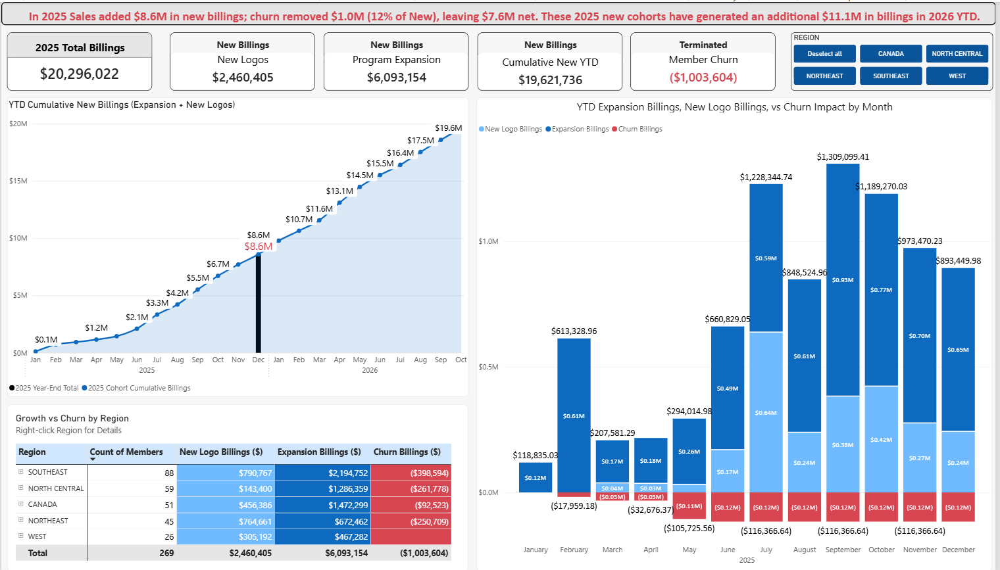
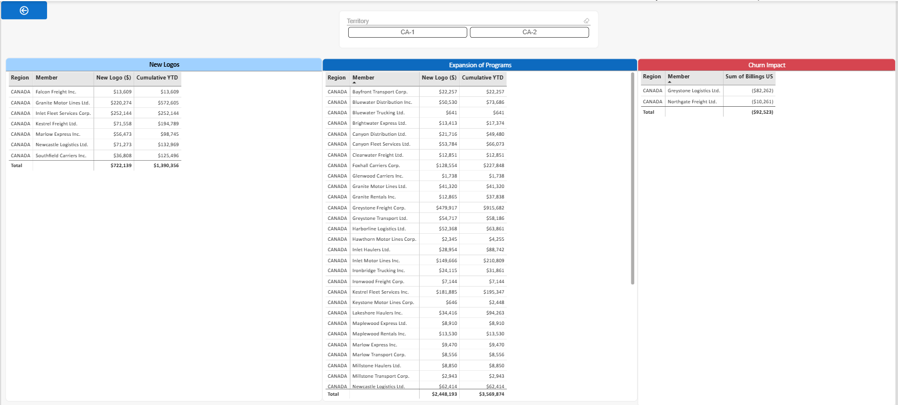

# Sales Performance Dashboard: New Logos, Expansion and Churn

A Power BI dashboard that shows where billings growth comes from, and what churn takes away. It separates **new customers (New Logos)** from **existing customers expanding into new supplier programs (Expansion)**, then nets out **Churn**, by region, territory and customer.

**All data in this project is synthetic.** Companies, people, IDs and amounts are invented for demonstration.





## Business questions it answers

1. How much of this year's billing growth came from brand-new customers, and how much from existing customers adding new supplier relationships?
2. How much billing did churned customers take with them, and what is the impact for the rest of the year?
3. How do the customers won in 2025 keep contributing in 2026?
4. Which regions and territories drive growth, and which drive churn?

## What is in the report

**Page 1: 2025 Sales Performance**
- KPI cards for total billings, New Logo billings, Expansion billings, 2025 cohort cumulative billings and churn billings.
- A region slicer that filters the whole page.
- A month-by-month chart of cumulative new billings (Expansion + New Logos) for the 2025 cohort.
- A column chart comparing New Logo billings, Expansion billings and churn by year.
- A matrix of region, territory and customer with the three measures, ready for drill-down.

**Page 2: Details**
- Customer-level tables showing billings by year and across all years.
- A territory slicer and a Back button to return to the overview.

## How the main numbers are defined

| Term | Meaning |
|---|---|
| **Billings (USD)** | Invoice amounts, with Canadian-dollar invoices converted to USD at the monthly exchange rate. |
| **New Logo** | Billings in the year a customer first joined the program. |
| **Expansion** | Billings from a customer-and-supplier relationship that first invoiced in that year, for a customer that joined earlier. |
| **Churn** | For each terminated customer, the average monthly billing over the 12 months before it left, shown as a negative amount for the remaining months of that year. |
| **Cohort** | The customer-and-supplier relationships that produced New Logo or Expansion billings in a given year. |

The full calculations are written up in [docs/dax-measures.md](docs/dax-measures.md).

## Skills demonstrated

| Area | What is in this project |
|---|---|
| Data modeling | Weekly invoice fact table, customer dimension, date table, an inactive relationship activated with `USERELATIONSHIP`, a bidirectional one-to-one helper table |
| DAX | Cohort logic with `CALCULATETABLE`, running totals, year-to-date measures, `ALL`-based filters, calculated tables and columns, dynamic headline text with `FORMAT` |
| Power Query | Parameter-driven CSV loading, type handling, merges and appends, custom columns, grouping with custom functions, a cross join to a calendar |
| Report design | KPI cards, combo and column charts, matrix with drill-down, slicers, a details page, a custom slicer visual |

## The data

Six synthetic CSV files in [data/](data/), built to look like a real B2B billing dataset: long-tailed invoice amounts, a small share of credit notes, some Canadian-dollar invoices, parent companies with several customers, and customers that terminate mid-year.

| File | Rows | What one row is |
|---|---|---|
| `Invoice_Detailed.csv` | 30,000 | A weekly invoice summary for one customer and supplier |
| `Invoice_Detailed_c.csv` | 30,000 | A compact copy of the same rows, used to build the calendar and churn tables |
| `FULL_BillTo.csv` | 420 | A customer (bill-to) |
| `BillTo_C.csv` | 372 | A customer, with sales-rep details |
| `BillFrom_C.csv` | 142 | A supplier record (US or Canadian) |
| `FirstInvoiceDate.csv` | 2,895 | The first invoice for a customer-and-supplier pair |

Invoices run from January 2023 to mid-November 2026. Every column is described in [docs/data_dictionary.xlsx](docs/data_dictionary.xlsx).

## Repository contents

```
README.md
data/                          Six synthetic CSV files
docs/                          DAX notes, data dictionary and screenshots
power-bi-project/              The report (Power BI Project / PBIP format)
  Sales Performance.pbip
  Sales Performance.Report/          Pages and visuals
  Sales Performance.SemanticModel/   Tables, measures, relationships, Power Query
```

You can read every measure and query as plain text on GitHub, under `Sales Performance.SemanticModel/definition/`.

## Open the report in Power BI Desktop

1. Install **Power BI Desktop** (Windows). If needed, turn on **File > Options and settings > Options > Preview features > Power BI Project (.pbip) save option** and restart.
2. Download or clone this repository, and copy the six files from `data/` into one folder on your computer.
3. Open `power-bi-project/Sales Performance.pbip`.
4. Go to **Home > Transform data > Manage parameters**, and set `DataFolder` to the folder from step 2. It defaults to `C:\Portfolio Data`.
5. Click **Close & Apply** to refresh.

## Notes

- **Dates move with the calendar.** The date table runs up to today's date and some measures use `TODAY()`, so year-to-date figures change as time passes. The invoices end in mid-November 2026, so months after that show no new billings.
- **Custom visual.** The territory slicer on the Details page is the free *Chiclet Slicer* from AppSource. Power BI will offer to install it the first time you open the page.
- **Year-specific measures.** Some measures are written for 2025 and 2026. They would need their years updated for other periods.

Built by [mishide](https://github.com/mishide).
